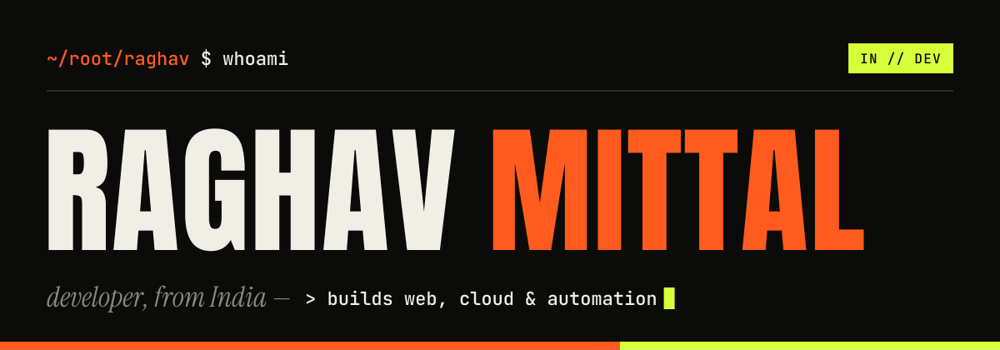

<picture>
  <source media="(prefers-color-scheme: dark)" srcset="assets/banner-dark.svg">
  <source media="(prefers-color-scheme: light)" srcset="assets/banner-light.svg">
  
</picture>

### `$ whoami`

I'm Raghav, a developer from India. I build web apps, mobile apps, cloud backends and the automation that holds them together, and I care most about things real people use every day.

I also take on client work under my own name at **[raghav1000000000.github.io](https://raghav1000000000.github.io/)**: redesigning, remaking and fixing business websites and software.

### `$ ls ./projects`

- **[MeetX](https://github.com/Raghav1000000000/meetx-social-discovery-cloud)**: a mobile-first app for meeting interesting people nearby, with discovery, short-lived chats, meetups, local offers and an admin dashboard. `TypeScript` `Expo` `Express` `MongoDB`
- **[ShubhSandesh](https://github.com/Raghav1000000000/shubhsandesh)**: festival greetings for Indian small businesses, with their name and logo on the post, a festival-morning reminder and one tap to send on WhatsApp. [Try the prototype ↗](https://raghav1000000000.github.io/shubhsandesh/prototype/)
- **[Scent Stories](https://github.com/Raghav1000000000/scent-stories)**: a gentle guide to perfume for beginners in India.

### `$ cat stack.txt`

```txt
languages   TypeScript · JavaScript · Python · Java
frontend    React · React Native (Expo) · HTML/CSS
backend     Node.js · Express · MongoDB
ship        Vercel · GitHub Pages · Git
```

### `$ ping raghav`

Want something built, or a site fixed? Reach me through **[my website](https://raghav1000000000.github.io/)**, or find me on **[LinkedIn](https://www.linkedin.com/in/raghavmittal100/)**.

<sub>`~/root/raghav` · `exit 0`</sub>
